<h3 align="Center"> Hello! I'm Azka Keandre Zuhdi </h3>

---
I'm Kean, a student majoring in Informatics at Telkom University. Currently exploring the fundamentals of programming, algorithms, and data structures. I'm soo excited to build my first projects, learn new technologies, and collaborate with fellow developers.

- 🎓 I’m currently pursuing a Bachelor of Informatics @ Telkom University
- 💻 I’m currently learning on Computational Logic, Fullstack Developer, Mobile Programmer.
- 🤝 I'm always open to collaborating on innovative projects and participating in hackathons or programming contests!

Reach me out:
- [Linkedin](https://www.linkedin.com/in/azkakeandrezuhdi/)
- [Website](https://keandre.framer.website/)

---
 

  

